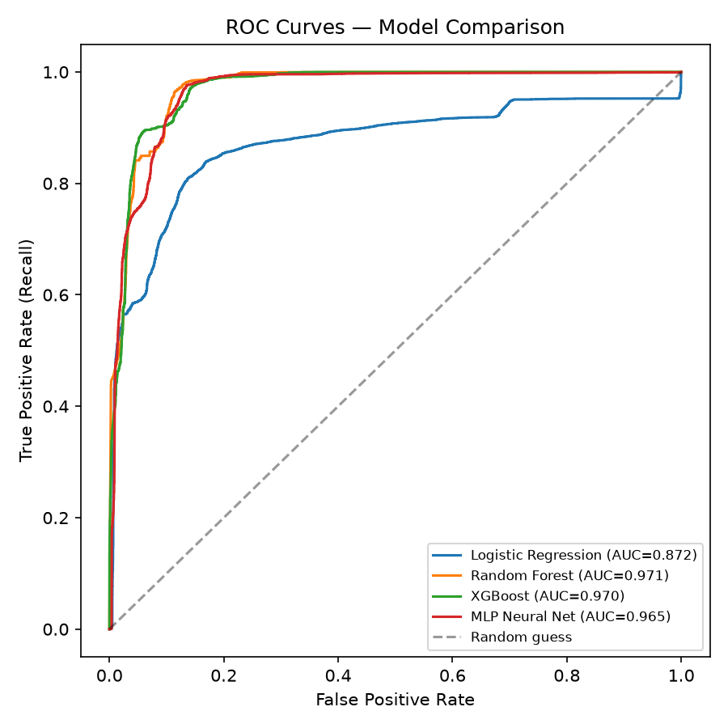

# ML-Based SOC Alert Triage

Can machine learning cut down the alert queue a Security Operations Centre (SOC) analyst has to review, without letting too many real attacks slip through?

This project frames alert triage as a binary classification problem (true positive vs. false positive) on the public **NSL-KDD** intrusion detection benchmark, compares four models, and evaluates them with metrics that matter operationally in a SOC: precision, recall, false positive rate, false negative rate, and simulated alert queue reduction.

## The problem

SOC analysts receive far more alerts than they can realistically investigate. Most are benign, but a missed real attack is costly. A triage model has to reduce analyst workload **and** keep missed attacks low. This repo explores that trade-off.

## Results

Evaluated on the NSL-KDD test set (22,544 records, which deliberately includes attack types not seen in training):

| Model | Precision | Recall | F1 | ROC-AUC | False Positive Rate | Simulated queue reduction |
|---|---|---|---|---|---|---|
| Logistic Regression | 0.925 | 0.618 | 0.741 | 0.872 | 6.6% | 62.0% |
| Random Forest | 0.967 | 0.624 | 0.758 | 0.971 | 2.8% | 63.3% |
| XGBoost | 0.968 | 0.673 | 0.794 | 0.970 | 2.9% | 60.5% |
| MLP Neural Net | 0.974 | 0.667 | 0.791 | 0.965 | 2.4% | 61.0% |



### Key takeaways

- All non-linear models reach about 97% precision on the alerts they flag, so analysts could plausibly trust them.
- Recall is only about 62-67%. Roughly a third of attacks in the test set are missed, largely because the test set contains attack types absent from training. This mirrors the real-world zero-day problem.
- The sensible deployment is therefore **queue prioritisation with a human in the loop**, not auto-closing alerts.
- "Queue reduction" is a simulation (only model-flagged alerts are escalated). It is not a measured result from a live SOC.

## Project structure

```
.
├── code/
│   ├── download_data.py   # fetches NSL-KDD into ./data
│   ├── preprocess.py      # loading, encoding, scaling
│   └── train_eval.py      # trains + evaluates all models, saves figures
├── results/               # generated metrics and plots
├── SOC_Alert_Triage_Report.docx   # full written report
├── requirements.txt
└── README.md
```

## Run it yourself

Requires Python 3.9+. Run all commands from the project root.

```bash
# 1. (Optional) create a virtual environment
python -m venv venv
source venv/bin/activate        # Windows: venv\Scripts\activate

# 2. Install dependencies
pip install -r requirements.txt

# 3. Download the dataset
python code/download_data.py

# 4. Train and evaluate all models (takes 1-3 minutes)
python code/train_eval.py
```

Outputs are written to `results/`: metrics (`model_comparison.csv/json`), ROC curves, confusion matrices, and feature importances.

## Method summary

- **Data:** NSL-KDD, 41 connection-level features, 125,973 training and 22,544 test records.
- **Preprocessing:** label-encode categorical features, standardise numeric features (scaler fit on train only), binarise label (normal = 0, any attack = 1).
- **Models:** Logistic Regression, Random Forest (200 trees), XGBoost (300 trees), MLP (64-32).
- **Metrics:** precision, recall, F1, ROC-AUC, FPR, FNR, simulated queue reduction.

## Limitations

- NSL-KDD is an older benchmark and does not reflect modern attack surfaces (cloud, containers, living-off-the-land techniques).
- Binary framing hides differences in severity between attack types.
- Hyperparameters are sensible defaults, not exhaustively tuned.
- Offline evaluation only: no concept drift, streaming, or SIEM integration.

## Future work

- Multi-class / severity-aware triage (DoS, Probe, R2L, U2R)
- Evaluation on CIC-IDS2017/2018 to test generalisation
- Anomaly detection (autoencoders, isolation forests) for novel attacks
- SHAP explanations so analysts see why an alert was flagged

## Dataset credit

NSL-KDD: Tavallaee, Bagheri, Lu, Ghorbani, "A Detailed Analysis of the KDD CUP 99 Data Set" (2009), Canadian Institute for Cybersecurity, University of New Brunswick.

## License

MIT (add a LICENSE file when you publish).
