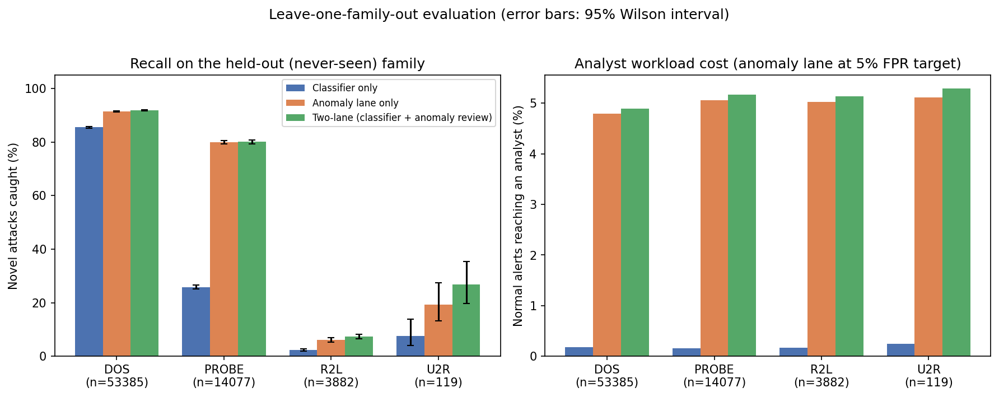

# ML-Based SOC Alert Triage

Can machine learning cut down the alert queue a Security Operations Centre (SOC) analyst has to review, without letting too many real attacks slip through?

This project frames alert triage as a binary classification problem (true positive vs. false positive) on the public **NSL-KDD** intrusion detection benchmark, compares four models, and evaluates them with metrics that matter operationally in a SOC: precision, recall, false positive rate, false negative rate, and simulated alert queue reduction.

## The problem

SOC analysts receive far more alerts than they can realistically investigate. Most are benign, but a missed real attack is costly. A triage model has to reduce analyst workload **and** keep missed attacks low. This repo explores that trade-off.

## Results

Evaluated on the NSL-KDD test set (22,544 records, which deliberately includes attack types not seen in training):

| Model | Precision | Recall | F1 | ROC-AUC | False Positive Rate | Simulated queue reduction |
|---|---|---|---|---|---|---|
| Logistic Regression | 0.925 | 0.618 | 0.741 | 0.872 | 6.6% | 62.0% |
| Random Forest | 0.967 | 0.624 | 0.758 | 0.971 | 2.8% | 63.3% |
| XGBoost | 0.968 | 0.673 | 0.794 | 0.970 | 2.9% | 60.5% |
| MLP Neural Net | 0.974 | 0.667 | 0.791 | 0.965 | 2.4% | 61.0% |


### Key takeaways

- All non-linear models reach about 97% precision on the alerts they flag, so analysts could plausibly trust them.
- Recall is only about 62-67%. Roughly a third of attacks in the test set are missed. About half of the misses are attack types absent from training, and most of the rest are very rare types (see error analysis below). This mirrors the real-world zero-day problem.
- The sensible deployment is therefore **queue prioritisation with a human in the loop**, not auto-closing alerts.
- "Queue reduction" is a simulation (only model-flagged alerts are escalated). It is not a measured result from a live SOC.

## Error analysis: where are the misses?

(`code/analyze_misses.py`, XGBoost at the 0.5 threshold)

- Recall varies enormously by attack family: about 85% on DoS and Probe, but only about 6.5% on R2L (remote-to-local, e.g. credential guessing). R2L accounts for most of the 4,200 missed attacks.
- 51% of misses are attack types never seen in training. Most of the rest are types with very few training examples (for example `guess_passwd`, 53 training records).
- A "lower-confidence lane" (auto-dismiss only when the attack probability is very low) helps only partially: even at a conservative cutoff, about 21% of attacks were still dismissed, because the model is often confidently wrong on novel patterns. These thresholds were explored on the test set, so treat them as exploratory.

### What does the 62-67% recall actually mean?

The official NSL-KDD split is not a random split: the test set has 37 attack types versus 22 in training (17 are test-only), and a different share of normal traffic. With the same XGBoost model:

| Evaluation | Precision | Recall |
|---|---|---|
| Random stratified 80/20 split of the training file | 0.999 | 0.999 |
| Official train/test split | 0.968 | 0.673 |

The 67% is best read as a distribution-shift stress test, not a real-world estimate. The 99.9% is too optimistic, because random splits leak known attack patterns into the test set. Real-world performance sits somewhere in between.

## Experiment: leave-one-family-out with an anomaly-detection review lane

(`code/lofo_experiment.py`)

To measure performance on genuinely novel attacks, each attack family (DoS, Probe, R2L, U2R) is held out of training entirely and used only as the "novel" test case. Three approaches are compared:

1. **Classifier only:** XGBoost trained on normal traffic and the other three families.
2. **Anomaly lane:** an Isolation Forest trained on normal traffic only. Its threshold is calibrated on held-out normal records so it flags a target share of normal traffic. Attacks are never used to set it.
3. **Two-lane triage:** the classifier escalates high-confidence attacks, and anything the anomaly lane finds unfamiliar goes to a review lane instead of being dismissed.

Novel-attack recall with the anomaly lane at a 5% false-alarm target (95% Wilson intervals are in `results/lofo_results.csv`):

| Held-out family | n (novel) | Classifier only | Anomaly lane only | Two-lane |
|---|---|---|---|---|
| DoS | 53,385 | 85.6% | 91.4% | 91.8% |
| Probe | 14,077 | 25.8% | 79.9% | 80.1% |
| R2L | 3,882 | 2.3% | 6.1% | 7.4% |
| U2R | 119 | 7.6% | 19.3% | 26.9% |



### Findings

- The anomaly review lane helps a lot where novel attacks look statistically different from normal traffic (Probe: 26% to 80%) and barely helps where they blend in (R2L: 2% to 7%).
- It has a real cost. The share of normal alerts reaching an analyst rises from about 0.2% (classifier only) to about 5% at the 5% target. At a 10% target, R2L recall rises to about 20% and U2R to about 41%, at a roughly 10% review burden.
- The benefit depends heavily on the family, so a single average would hide it. U2R has only 119 records, so its intervals are wide (26.9%, CI about 20-36%).
- Takeaway: an anomaly lane is a useful addition for some novel attack types, but it is not a fix for stealthy attacks that resemble normal behaviour.

### Caveats

- The official train and test files are pooled and known traffic is split randomly 70/30, so recall on known attacks (about 98-99%) is optimistic. The novel-family recall is the number of interest.
- One detector (Isolation Forest), one random seed, and default hyperparameters. Other detectors (autoencoders, one-class SVM) were not tested.
- Families are the coarse DoS/Probe/R2L/U2R taxonomy. Holding out individual attack types would be a stricter test.

## Project structure

```
.
├── code/
│   ├── download_data.py   # fetches NSL-KDD into ./data
│   ├── preprocess.py      # loading, encoding, scaling
│   ├── train_eval.py      # trains + evaluates all models, saves figures
│   ├── analyze_misses.py  # per-attack-type error analysis + two-lane threshold test
│   └── lofo_experiment.py # leave-one-family-out + anomaly review lane
├── results/               # generated metrics and plots
├── SOC_Alert_Triage_Report.docx   # full written report
├── requirements.txt
└── README.md
```

## Run it yourself

Requires Python 3.9+. Run all commands from the project root.

```bash
# 1. (Optional) create a virtual environment
python -m venv venv
source venv/bin/activate        # Windows: venv\Scripts\activate

# 2. Install dependencies
pip install -r requirements.txt

# 3. Download the dataset
python code/download_data.py

# 4. Train and evaluate all models (takes 1-3 minutes)
python code/train_eval.py
```

Outputs are written to `results/`: metrics (`model_comparison.csv/json`), ROC curves, confusion matrices, and feature importances.

Optional extra analyses:

```bash
python code/analyze_misses.py     # per-attack-type error analysis
python code/lofo_experiment.py    # leave-one-family-out experiment (a few minutes)
```

## Method summary

- **Data:** NSL-KDD, 41 connection-level features, 125,973 training and 22,544 test records.
- **Preprocessing:** label-encode categorical features, standardise numeric features (scaler fit on train only), binarise label (normal = 0, any attack = 1).
- **Models:** Logistic Regression, Random Forest (200 trees), XGBoost (300 trees), MLP (64-32).
- **Metrics:** precision, recall, F1, ROC-AUC, FPR, FNR, simulated queue reduction.

## Limitations

- NSL-KDD is an older benchmark and does not reflect modern attack surfaces (cloud, containers, living-off-the-land techniques).
- Binary framing hides differences in severity between attack types.
- Hyperparameters are sensible defaults, not exhaustively tuned.
- Offline evaluation only: no concept drift, streaming, or SIEM integration.
- The official split mixes novel attack types with rare ones and shifts the class balance, so headline recall is not a real-world estimate (see above).

## Future work

- Multi-class / severity-aware triage (DoS, Probe, R2L, U2R)
- Evaluation on CIC-IDS2017/2018 to test generalisation
- Compare other anomaly detectors (autoencoders, one-class SVM) and hold out individual attack types rather than families
- Tune the review-lane threshold on a proper validation set and measure analyst workload against a realistic alert volume
- SHAP explanations so analysts see why an alert was flagged

## Dataset credit

NSL-KDD: Tavallaee, Bagheri, Lu, Ghorbani, "A Detailed Analysis of the KDD CUP 99 Data Set" (2009), Canadian Institute for Cybersecurity, University of New Brunswick.

## License

MIT (add a LICENSE file when you publish).
